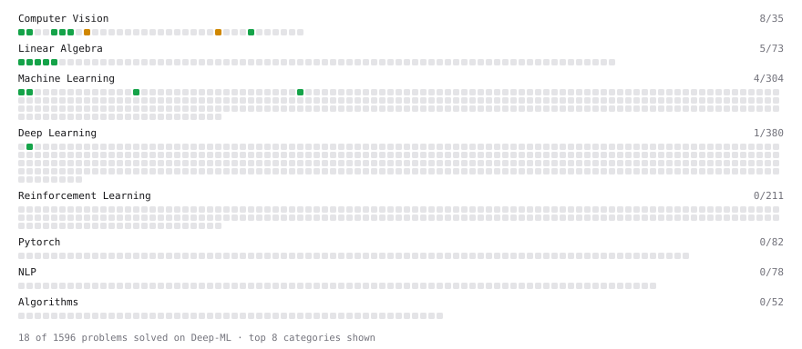

# Deep-ML

My machine learning practice from [Deep-ML](https://www.deep-ml.com). Every solution here was written by hand.

**14** solved · 13 problems · 0 labs · 1 math

[**Browse the interactive portfolio**](https://SoubhikMajumdar.github.io/deep-ml/) to replay this filling in over time.

## Problems

| | Difficulty | Solved | |
| --- | --- | --- | --- |
| [Binary Classification with Logistic Regression](https://www.deep-ml.com/problems/104) | easy | 2026-08-21 | [solution](problems/0104-binary-classification-with-logistic-regression) |
| [Calculate Accuracy Score](https://www.deep-ml.com/problems/36) | easy | 2026-07-20 | [solution](problems/0036-calculate-accuracy-score) |
| [Calculate Image Brightness](https://www.deep-ml.com/problems/70) | easy | 2026-07-21 | [solution](problems/0070-calculate-image-brightness) |
| [Calculate Mean by Row or Column](https://www.deep-ml.com/problems/4) | easy | 2026-08-10 | [solution](problems/0004-calculate-mean-by-row-or-column) |
| [Convert RGB Image to Grayscale](https://www.deep-ml.com/problems/237) | easy | 2026-01-27 | [solution](problems/0237-convert-rgb-image-to-grayscale) |
| [Linear Regression Using Gradient Descent](https://www.deep-ml.com/problems/15) | easy | 2026-07-17 | [solution](problems/0015-linear-regression-using-gradient-descent) |
| [Linear Regression Using Normal Equation](https://www.deep-ml.com/problems/14) | easy | 2026-07-02 | [solution](problems/0014-linear-regression-using-normal-equation) |
| [Matrix-Vector Dot Product](https://www.deep-ml.com/problems/1) | easy | 2026-01-30 | [solution](problems/0001-matrix-vector-dot-product) |
| [Reshape Matrix](https://www.deep-ml.com/problems/3) | easy | 2026-08-21 | [solution](problems/0003-reshape-matrix) |
| [Scalar Multiplication of a Matrix](https://www.deep-ml.com/problems/5) | easy | 2026-07-17 | [solution](problems/0005-scalar-multiplication-of-a-matrix) |
| [Softmax Activation Function Implementation ](https://www.deep-ml.com/problems/23) | easy | 2026-08-21 | [solution](problems/0023-softmax-activation-function-implementation) |
| [Transpose of a Matrix](https://www.deep-ml.com/problems/2) | easy | 2026-01-30 | [solution](problems/0002-transpose-of-a-matrix) |
| [Sobel Edge Detection](https://www.deep-ml.com/problems/241) | medium | 2026-08-24 | [solution](problems/0241-sobel-edge-detection) |

## Math

| | Difficulty | Solved | |
| --- | --- | --- | --- |
| [Matrix Multiplication](https://www.deep-ml.com/math-problems/10) | medium | 2026-08-13 | [solution](math/0010-matrix-multiplication) |

---

_This file is regenerated by Deep-ML on every push._
